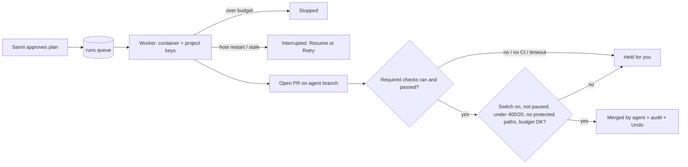

# GEOSAN Workshop redesign: design spec

- **Status:** Approved by Sanni, 20 Oct 2026. The decisions Sanni approved are in §10.
- **Date:** 2026-10-20.
- **Process:** Superpowers brainstorm → spec → plan. Each PR gets a pstack review.
- **Sources (credited):**
  - Supervisor: `geosan-context/BRIEF.md`.
  - **Ai & Cloud Engineer:** `geosan-design/data-and-keys.md`, the core of §4, §5 and the step 1–3 server PRs.
  - **UI/UX:** `redesign/plan.md`, the core of §7 and the UI PRs, and a hard-coded projects audit (89 entries in 49 files, kept by UI/UX outside the repo).
  - **DevOps:** `geosan-design/app-server-hosting.md` (§3), plus the guard rules shared with the Supervisor and Ai & Cloud Engineer.

## 1. Goal
AetherOrch should handle any number of client projects, not four hardcoded ones.
- Adding a client or a project takes one form.
- Each project has its own repo, keys, budget and design kit.
- After Sanni approves a plan, the agent does the work, opens a PR, and may merge it under strict guards.

## 2. Decisions (final)
1. **One user.** Only Sanni. No team roles and no client logins. Sign-in and every database rule are locked to Sanni's account. The "staff operator" fallback works only in local demo mode.
2. **Clients and projects.** A client has many projects. A project has exactly one GitHub repo, and a repo belongs to only one project. The repo may be connected after the project is created, but no run starts until it is.
3. **Per-project keys and budget.**
   - Each project has its own AI keys and budget, plus a GitHub token scoped to its repo.
   - Keys are encrypted on the server, write-only, and shown only as their last 4 characters.
   - There is no fallback to other keys. A missing key fails closed.
   - Adding a project needs no env edit and no restart.
4. **After approval, the agent ships.** It opens a PR and merges it itself if the checks pass and the run is within budget.
5. **Auto-merge is off by default for each project.** Sanni turns it on per project. A global pause stops all runs and merges.
6. **Runs execute inside `server.js`** on an always-on host. They are queued in Supabase and processed one at a time.
7. **The GEOSAN-WORKSHOP repo itself is never auto-merged.** Every PR to it waits for Sanni's yes.
8. **The shadcn/ui foundation PR comes first in step 2.** It makes no visual change, so new screens are built only once.
9. **The auto-merge size limit is 400 changed lines and 20 files** (UI/UX's suggestion).

## 3. Architecture and hosting
- **Frontend:** Vite/React, staying on Vercel. It calls `server.js` through `VITE_PROXY_URL`, uses Supabase Auth for sign-in, and CORS is limited to the Vercel domain.
- **`server.js`:** the API behind PR #3's guards. A request passes through `assertLocalHost`, then `assertBrowserSafe`, then `authenticate`, then the `OWNER_USER_ID` check. The run worker lives in the same server.
- **Supabase:** Postgres plus Auth. Browser access is limited to Sanni's rows. Secrets can be read only with the server's service-role key.
- **GitHub:** the client repos. Their CI is the only test signal.

**Run worker** (`server/runWorker/`):
- **Claiming:** it claims the oldest `queued` run atomically. Concurrency is `RUN_CONCURRENCY=1` for now and configurable later.
- **Resumable steps:** each run is split into short steps, and each step writes a `run_events` row with a rising `seq`.
- **Interruptions:** if a heartbeat goes stale, or the server restarts, the run becomes `interrupted`. The last completed step is kept, and Sanni can **Resume** (next step) or **Retry** (that step).
- **Sandbox:** each run gets a throwaway Docker container and working dir (memory limit, outbound restricted), removed when the run ends. A sweep on startup removes leftovers.
- **Keys:** only that project's keys are decrypted. They stay in the `server.js` process for that run and never enter the container or the disk.
- **Repo access:**
  - The repo is downloaded as a tarball through the guarded GitHub client.
  - Commits go via the Git Data API to `agent/<run-id>`.
  - v1 runs no client install or test scripts. CI decides. A later version can run tests inside the container.
- **Outbound network:** one fetch wrapper with an allowlist (GitHub, the AI providers, Supabase), plus a host firewall.

**Trade-off and migration path:**
- Isolation is weaker than a separate runner: `server.js` holds the master key and controls Docker.
- The worker reads only the queue table, so it can later move to a separate worker or host with the same code and queue.

**Hosting** (DevOps; prices checked 2026-10-20, excluding tax):

| Option | Price | Trade-offs |
|---|---|---|
| **DigitalOcean Basic Droplet, 2 GiB (chosen, see §10)** | **$12/mo** | Docker container per run, outbound Cloud Firewall, accepts PayPal. Sanni maintains the server (OS patches, restarts); DevOps automates updates. |
| Railway Hobby | about $10/mo (estimate) | Easiest: native GitHub deploys, nothing to maintain. But there's no per-run container and no outbound firewall, so it **does not meet the isolation requirement**. |
| Fly.io, shared-cpu-2x 2 GB plus 20 GB volume | about $16.39/mo | A VM per run, deny-outbound network policies, strongest isolation. A credit card is required. |

**Ruled out:**
- Vercel Functions (5–30 min limit).
- Render ($30, no Docker daemon).
- Koyeb (≈$29.71, $29 card hold).
- The free tiers of Render, Koyeb and Railway (they sleep).
- Oracle Always Free (idle machines get reclaimed).
- GCP e2-micro (too small).
- Hetzner (cheapest, but out of stock today).

**Deploy pipeline** (DevOps):
- GitHub Actions on push to `main`:
  1. `npm ci`, `npm run verify`, `npm test`.
  2. Build the image and push it to GHCR.
  3. Deploy with SSH and `docker compose pull && up -d`.
  4. The `/healthz` gate: the job fails if the check fails.
- Rollback means redeploying the previous image.
- Secrets live on the host (a root-only `.env`), never in GitHub, apart from the deploy credential.
- **Prerequisites:** an `npm test` script, a `/healthz` route, and #1's fix to `clean` (it no longer deletes `server.js`).

## 4. Data model (core: Ai & Cloud Engineer; read models from UI/UX)
- Every table has `owner_id`, with RLS `owner_id = auth.uid()`. The `using (true)` policies are dropped.
- Changes are numbered files in `supabase/migrations/`.
- Archiving is used instead of hard deletes.

| Table | Key fields / notes |
|---|---|
| `clients` | name, slug, industry, notes, **default_kit**, **default_monthly_budget_usd**, archived_at, is_demo. New projects are pre-filled from the client's defaults. |
| `projects` | client_id, name, slug, **repo_slug (unique, nullable until connected)**, default_branch, ci_state, required_checks, monthly_budget_usd, per_run_cap_usd, kit (a copy of a preset), **auto_merge_enabled (default false)**, extra_protected_paths, status, archived_at, is_demo |
| `project_secrets` | project_id, provider, ciphertext, iv, auth_tag, last4, key_version, verified_at. `unique(project_id, provider)`, and no browser policy. |
| `secret_audit` | secret_id, action, actor, result. Never holds key values. |
| `design_kit_presets` | The four current kits renamed by pattern, plus Blank, plus kits Sanni saves. Picking one copies it into the project. |
| `agent_tasks` (exists) | Plus goal, constraints, done_when. A plan is a task in `awaiting_approval`. |
| `approvals` | Replaces the in-memory `approvalLog.ts`. |
| `runs` | The queue: status (queued/running/interrupted/held/ready_to_merge/merged/stopped/failed/cancelled), last_completed_step, pr_number, head_sha, spend_usd, heartbeat_at |
| `run_events` | run_id, seq, step, kind, detail. Served by `GET /runs/:id/events?after=seq`, by polling or SSE. |
| `merge_audit` | run_id, pr_number, head_sha, checks_seen, size, spend, mode (auto/manual), overridden holds, reverted_by_pr |
| `cost_events` (exists) | Plus client_id and run_id. |
| `app_settings` | global_pause, run_concurrency |

**The four current projects** (EHI Multisystems, Iyanuoluwa Vegetable Oil, Aviation Log Entry, EdgePoint) are imported once as **real client records** (`is_demo = false`), each with a single canonical ID. Separately, demo mode uses a generic seed (`src/data/demoSeed.ts`, `is_demo`, with a `stress` variant) that can be removed with one click.

## 5. Keys and security (core: Ai & Cloud Engineer, with DevOps)
- **Encryption:**
  - AES-256-GCM with a random IV for each secret, bound to project and provider.
  - `SECRETS_MASTER_KEY` lives in server env only. If it is missing, the key routes return 503.
  - Rotation uses `SECRETS_MASTER_KEY_PREVIOUS` and `npm run secrets:rotate`.
- **Write-only:**
  - `PUT …/secrets/:provider` returns `{provider, last4, verified}`.
  - "Test key" is limited to 5 calls a minute.
  - Values never reach logs, errors or the bundle, and a CI canary grep checks this.
- **Lookup:** `resolveCredentials(projectId, provider)` replaces `loadProjectCredentials`. If the project has no key, it returns 403 with "add one in project settings".
- **Env import:** env values are imported once. After that the database is the only source, and the draft's env fallback is removed so missing keys fail closed.
- **GitHub token:** a fine-grained PAT for that one repo, with Contents RW, Pull requests RW, Checks R, Commit statuses R and Metadata R. **No Administration.** The force-push block stays.
- **Budget:**
  - Before each AI call, the project's month-to-date spend (and the run cap, if set) is checked.
  - If over, the run **stops**. The global weekly ledger stays as an outer cap.
- **Sign-in:**
  - The session must match `OWNER_USER_ID`, and public sign-ups are turned off.
  - The staff fallback needs `VITE_DEMO_MODE=true` and a `localhost` page.

## 6. Run and auto-merge flow
1. **Approve & Run** writes `approvals` plus a `queued` run. While paused, no run is claimed and nothing merges, and a running run halts before its next AI call.
2. **Worker setup:** the worker claims the run, creates the container and decrypts the keys.
3. **Agent loop:** the budget is checked before each AI call.
4. **Commit and open the PR.**
5. **Wait for checks:** the worker waits for the required checks on the **current head SHA**. If they haven't finished after `CHECKS_TIMEOUT_MIN` (60), the run is held.
6. **Merge guards** (all must pass):
   - Not paused, and the switch is on. The switch is disabled while CI isn't detected.
   - Required checks exist, through a ruleset or branch protection.
   - Every required check **ran** and passed on the head SHA. Skipped, neutral or missing checks count as a fail.
   - Spend is within budget.
   - The diff is no more than **400 lines and 20 files**.
   - No protected path is touched, counting renamed files' old paths:
     - CI configs (`.github/workflows/**`, `.gitlab-ci.yml`, `.circleci/**`)
     - secrets (`.env*`, `**/secrets/**`, `*.pem`)
     - DB rules and migrations (`supabase/**`, `**/migrations/**`, `*.sql`, `**/policies/**`, `**/*rls*`, `prisma/**`)
     - auth code (`**/auth/**`, `*auth*.{ts,tsx,js}`, `middleware.*`)
     - plus the project's own extra paths. These can be added to, never removed.
   - GitHub's branch protection accepts the merge.
7. **Merge** with `sha=<head_sha>`, then write `merge_audit` (mode `auto`).

**Outcomes:**
- **Held for you:** the run lists every failed guard, each with its own action. Sanni may **Review & merge** manually (protected files need a "reviewed" checkbox). This is logged as `manual`.
- **Over budget:** the run stops. Sanni can raise the cap and resume.
- **Undo:** opens a revert PR, never a force-push. Sanni's click counts as approval, so the revert PR merges once its required checks pass, even when auto-merge is off. Global pause still applies.

**Allowlist additions in step 3** (owner: Ai & Cloud Engineer). Each is limited to the project's own `repo_slug` and sits behind #3's guards:
- Create `refs/heads/agent/*`.
- Open a PR.
- **Read branch protection and rulesets.**
- **Read check runs** (and statuses).
- **Read PR files**, and the PR itself.
- **Create a revert PR.**
- Tarball read.
- Merge only through the guarded `POST /api/projects/:id/pulls/:n/merge` (or the worker), never through the general proxy.

## 7. Screens (UI/UX, from `plan.md`)
- **Routes:** each screen has its own URL, for example `/clients`, `/c/:client`, `/c/:client/:project/(work|verify|settings)` and `…/runs/:id`, `/merges`, `/kits`. They are kept in sync through `pushState`, with no router library.
- **Portfolio (Build › Clients):** projects in a table grouped by client, with search, filters, a "Needs me first" sort, and virtualisation for big lists.
- **Client page:** Projects / Activity / Notes tabs, plus editing the client's default kit and budget. **Add client** is a dialog.
- **Add project:** a full page with steps:
  - basics;
  - repo (pick an existing repo, or connect one later; the app never creates repos), with CI detection shown on the page;
  - design kit (pre-filled from the client's default; or a preset, Blank, or a copy from another project);
  - budget (pre-filled from the client's default) and guardrails;
  - review.

  Auto-merge is shown as Off.
- **Project settings:**
  - Masked keys with Test / Replace.
  - Repo & CI status (detected or not, with the check names).
  - Merge & guardrails, where the **auto-merge switch** has a **track-record hint** ("Last 10 PRs: 9 passed CI first time · 0 reverted").
  - Design-kit editor, connections, budget, and archive.
- **Client / Project switcher:** in the breadcrumb, ⌘K / ⌘J, and a sidebar with Pinned and Recent (5).
- **Run page:**
  - A timeline driven by events (polling or SSE, never one long request), showing real spend.
  - An **Interrupted** banner with Resume / Retry.
  - A **Held for you** banner covering all six hold kinds, a Ready to merge state, and a plan-too-big hint.
- **Merge log:** global and per project. It marks "Merged by agent" with **Revert**.
- **Inbox:** one view across all projects, with Waiting on you · Held · Interrupted · Failing · Working.
- **Global pause:** a toggle in the top bar, with a banner.
- **Design system:**
  - shadcn/ui (Radix, new-york) aliased to PR #1's Cream and Obsidian tokens, with zero visual change at first.
  - MultiAccountComponentHub, ProjectWizardModal and TaskWorkspace are split under `src/features/*`.
  - About 7.4k lines of dead code are deleted (UI-1b, plus 1.3's removal of `initialData.ts` and `githubSync.ts`).
  - The four-kit modules are replaced by per-project kit copies.
  - A design-lint ratchet blocks any new use of the old style classes.

## 8. Steps and PRs
Every PR gets a DevOps pstack review and needs Sanni's yes. UI PRs are checked in both themes and at 375px.

**Step 0:** merge #1, then #4, then #3, rebased after #1.

**Step 1: lock sign-in and DB, fix IDs**
- **1.1, PR #5 (`fix/lock-db-to-owner`)** (Ai & Cloud Engineer): owner-only DB rules, the migrations folder, and the client sending the user's token instead of the anon key.
- **1.2, new small PR** (Ai & Cloud Engineer): the staff fallback only works with `VITE_DEMO_MODE=true` on localhost, the server checks `OWNER_USER_ID`, and login tokens refresh.
- **1.3** (Ai & Cloud Engineer): remove the hardcoded projects and fix the IDs. Ai & Cloud Engineer owns all of it:
  - `initialData.ts`, `mockData.ts` and `githubSync.ts`;
  - the `proj-ehi-001` fallbacks;
  - **one canonical ID per project**, replacing the three ID schemes (F1);
  - **`org-ehi-global` in 20+ places** (F5);
  - **the test script requiring exactly 4 projects** (F7, `full-system-test.ts:52`);
  - the `TaskWorkspace.tsx:133-158` bug, where an operator-precedence mistake shows EHI's fake "Kano Hub" task in every project (F3).
- **UI-1a** (UI/UX): demo-mode login copy ("Continue in Demo Mode", no client names).
- **UI-1b** (UI/UX): delete the 12 unused components and other dead code, coordinated with 1.3, which owns `initialData.ts` and `githubSync.ts`.
- **UI-1c** (UI/UX): replace the fixed four-kit design files (`verticalKits.ts`, `designBrief.ts`, `copyDeck.ts`, `goldenFixtures.ts`, `ReferenceBoard.tsx`) with a generic per-project kit and a preset list.

UI/UX's step 1 covers only UI-1a to UI-1c. Hardcoded projects and IDs are 1.3.

**Step 2: clients, projects, keys, budgets, screens**
- **2.0** (UI/UX, **first**): shadcn/ui foundation. No visual change, proved by a token snapshot and a screenshot diff.
- **2.1–2.4** (Ai & Cloud Engineer):
  - 2.1 Crypto.
  - 2.2 Tables plus `ProjectStore`.
  - 2.3 `resolveCredentials`, the env import and budgets.
  - 2.4 API (clients, projects, keys, key test, audit, archive).
- **2.5** (Ai & Cloud Engineer): import the four current projects as real client records, the generic demo seed, and kit presets stored in the DB.
- **UI-2a–2f** (UI/UX):
  - UI-2a URLs per screen.
  - UI-2b Portfolio grouped by client.
  - UI-2c Client page and Add client.
  - UI-2d Add-project flow.
  - UI-2e Project settings with masked keys and the CI status line. It shows "not checked yet" until 3.3 adds the rulesets read.
  - UI-2f Switcher.
- **2.6** (Ai & Cloud Engineer, DevOps): proof run with probes, the canary grep and the system test.

**Step 3: run engine, PRs, auto-merge, run screens**
- **3.1–3.4** (Ai & Cloud Engineer):
  - 3.1 Queue and event tables.
  - 3.2 Worker (claim, heartbeat, interrupt and resume, container, egress).
  - 3.3 **The allowlist additions in §6** and the agent loop.
  - 3.4 Guards, merge, audit, revert and global pause, with a test for each refusal.
- **UI-3a–3g** (UI/UX):
  - UI-3a Run model and event transport.
  - UI-3b Run timeline.
  - UI-3c Interrupted state with Resume / Retry.
  - UI-3d Held-for-you banner.
  - UI-3e Auto-merge toggle with the track-record hint, and the pause toggle.
  - UI-3f Merge log with revert.
  - UI-3g Inbox across projects.
- **3.5** (DevOps): the host, the deploy pipeline and its prerequisites, and a live end-to-end run on a test repo.

**Step 4: remaining shadcn migration** (UI/UX)
- UI-4a `dark:` variant fix.
- UI-4b Wrap the app primitives.
- UI-4c Shell.
- UI-4d–g Screen groups.
- UI-4h Delete the legacy CSS.

## 9. Risks
- **Shared host.** `server.js` holds the master key and the Docker socket. Mitigations: containers per run, keys kept out of containers, egress limits, and moving the worker out later.
- **Weak client CI.** Checks must be required and must actually have run.
- **Prompt injection.** The guards run on the server, and protected paths always wait.
- **Lost master key.** Every key would have to be re-entered.
- **One host.** Queued runs survive in Supabase, and interrupted runs can resume.
- **Self-managed server** (DigitalOcean). Patching is automated by DevOps, but Sanni owns the account.

## 10. Decisions (approved 20 Oct 2026)
1. **Host:** DigitalOcean Basic Droplet, 2 GiB, $12/mo. Each run gets a container, and there is an outbound firewall. Sanni maintains the server; DevOps automates updates.
2. **Key storage:** keys are encrypted in Supabase.
3. **`SECRETS_MASTER_KEY`:** it lives in the host env, and Sanni keeps a backup in their password manager.
4. **Auto-merge limits:** 400 changed lines and 20 files, with the §6 protected paths as written.
5. **Undo:** revert PRs auto-merge once checks pass, even with auto-merge off. The click counts as Sanni's approval.
6. **Client defaults:** clients carry a default kit and budget, which pre-fill new projects.
7. **Repos:** the app does not create repos. Projects connect existing repos only.
8. **The four current projects** stay as real client records.
